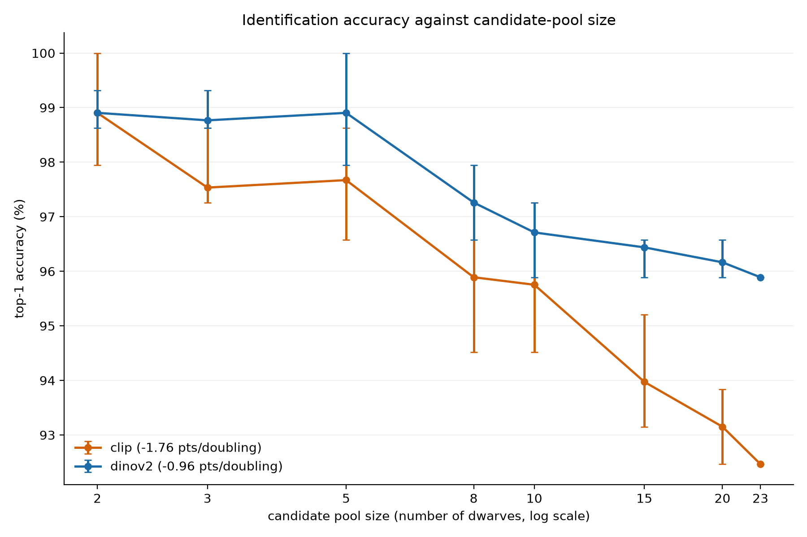
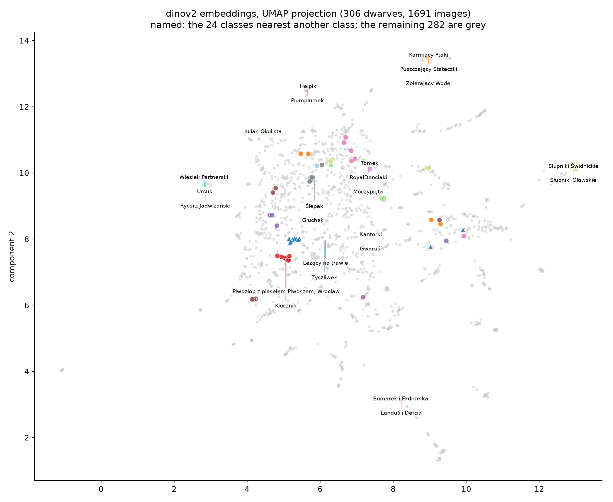
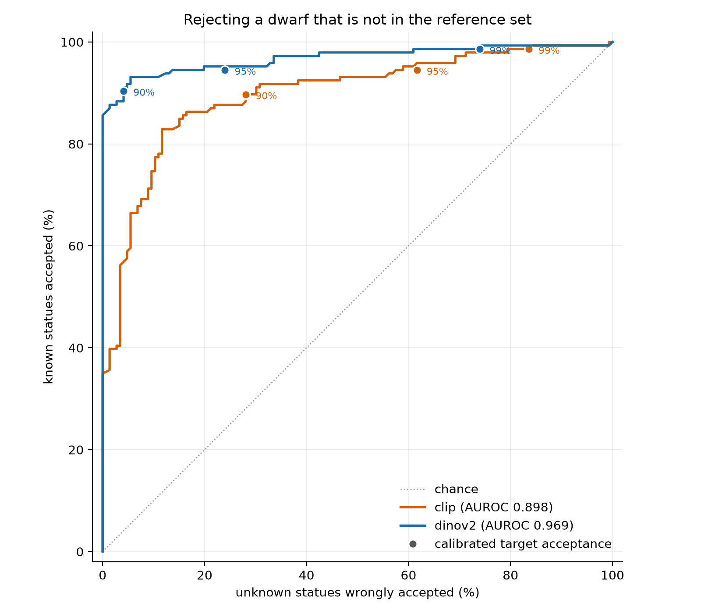

# Experiments

[Back to the README](../README.md) · [All guides](README.md)

Each experiment reads cached vectors and the evaluation split, writes one artifact under `results/`, and has a section in [RESULTS.md](../RESULTS.md) recording what it found. Pass `--override backbone=clip` (or any packaged backbone) to repeat one on another model.

## Overview of the findings

DINOv2 reaches 93.1% top-1 across a 306-dwarf pool with no fine-tuning, losing 0.79 accuracy
points per doubling of the candidate pool where CLIP loses 2.06 and accelerates. Narrowing by real
location helps *less* than random subsampling suggests, a trained classifier helps only the weaker
backbone, and the most frequent confusions are between lookalike statues, though most errors are
diffuse. Thresholding
similarity to answer "I don't know this one" worked at 23 classes and **does not** at 306 — one of
three conclusions the larger dataset overturned. Queries shot on phones rather than cameras cost
DINOv2 5.3 top-1 points and CLIP 15.6, which is a lower bound on what a real street photograph
would cost. And identifying a statue from *someone else's* photograph costs DINOv2 2.6 points but
CLIP 13.2 — CLIP leans on the photographer five times as hard. Verifying geometry on the top
candidates recovers some of that: **94.0% for DINOv2 and 86.3% for CLIP**, and 79% of the gain
survives when the photographer's own photographs are withheld. It goes no further because of the
first stage's recall, and a larger candidate list, backbone fusion and query expansion were all
measured and all failed. Geometry does not rescue rejection either — 0.65 AUROC points for DINOv2
and 2.3 for CLIP, with four-fifths of unknown statues still accepted — because a known query's 144
average inliers collapse to 17 once its own photographer is withheld, making geometry *more*
photographer-dependent than appearance rather than less. Neither of the two ways out works. A
DINOv2 at 3.5x the parameters moves that first-stage ceiling by **0.17 points**, winning 22
queries and losing 20 — what it does buy is 2.59 points of robustness to a change of photographer.
And SIFT promoted to the first stage, ranking all 1,690 references by inlier count with no
embedding involved, reaches **43.5%** in the top ten where cosine reaches 90.8%, rescuing 12% of
what cosine loses for seven seconds a photograph. A learned matcher rescues a third.

Across thirteen frozen backbones, models trained for invariant embeddings identify best — C-RADIOv3
94.7%, DINOv3 94.4%, DINOv2 93.1% — while MAE, BEiT and I-JEPA, under the same fixed pooling rule,
reach 47–56%; EVA-02, masked-modelled against CLIP features, reaches 84.5%. With weights chosen on
held-out statues, learned verification raises DINOv2's cross-photographer top-1 from 81.8% to
**84.4%** (DISK+LightGlue) and **85.5%** (LoFTR) where SIFT adds nothing measurable, still adds
2.0 points on DINOv3's shortlists, and recovers all of its gain when only the 30% of queries with
the smallest cosine margin are verified. Location as a weight rather than a filter lifts DINOv2 from
93.4% to **98.7%** over the placed statues, for any kernel scale from 50 to 800 m. A margin between
the two best statues cuts DINOv3's false acceptance of unknown statues from 21.6% to **7.7%**. Much
of the cross-photographer drop is scarcity: with one reference of the right statue left DINOv2
scores 60%, with six or more 92%. A compact multi-vector representation does not substitute for
verification.

*What the accuracy numbers are an average over. Each query is followed by the five dwarves each
backbone ranks highest, green for the correct statue. The four rows are not hand-picked: folds are
grouped by which backbones ranked the right statue first and the first query in image-ID order
represents its group, so this is what the ordinary case, the gap between the backbones, and their
shared failures actually look like. Regenerate with `krasnal-id visualize retrieval-examples`.*

*Why a learned matcher wins, in one pair. Both rows show the same two photographs of the same
statue, taken by different people. SIFT finds **5** verified correspondences; DISK+LightGlue finds
**123**, and puts them on the statue rather than the street behind it. Against the lookalike SIFT
actually chose — a different Słupnik — the counts are **4** and **8**: SIFT cannot separate the two
statues, and the learned matcher can. Redraw for any two photographs with
`krasnal-id visualize matches --query A.jpg --candidate B.jpg`.*

## Candidate-pool-size ablation

Measure the headline curve, accuracy against candidate-pool size:

    uv run krasnal-id experiment pool-ablation
    uv run krasnal-id experiment pool-ablation --override backbone=clip

Each query is scored against its own dwarf plus a sampled set of others, which simulates the
candidate narrowing a location-aware tool would perform. Every pool size is measured once per
configured seed and reported with the observed spread across seeds as its error bars. Configured
pool sizes larger than the available class count are skipped with a warning, and the full pool is
always measured. Results are written to `results/pool_size_ablation-<backbone>.json`.

*The headline curve. Error bars are the observed spread across seeds. Draw it from saved results
with `krasnal-id visualize ablation`.*

The reported `top_1_points_per_doubling` is a least-squares fit of top-1 accuracy against
log2 pool size over every measured size. Small pools sit near the accuracy ceiling, so the fit is
a conservative estimate of degradation in the larger-pool regime. See `AGENTS.md` §7.1 for the
dataset-scale decision this result is framed by, including why extrapolating past the current
class count is optimistic.

## Confusion analysis and embedding visualization

Find the dwarf pairs that systematically compete for the same queries:

    uv run krasnal-id experiment confusion
    uv run krasnal-id experiment confusion --override backbone=clip

Every query contributes its strongest wrong candidate, not only the queries that were
misidentified, because near-misses carry most of the signal on a dataset with few outright
errors. Pairs are directed: a mutual confusion appears once per direction rather than being
averaged into one entry. The margin is the correct dwarf's best similarity minus the
competitor's, so it is negative exactly when the query was misidentified. Results are written
to `results/confusion-<backbone>.json`.

Project the cached vectors into a labeled two-dimensional figure:

    uv sync --extra analysis
    uv run krasnal-id visualize embeddings
    uv run krasnal-id visualize embeddings --override experiment.method=tsne

*With 306 classes the figure names only the 24 sitting closest to another class and greys the
rest. That selection uses nothing but centroid distance, and it picks out the same Słupniki pair
and water-themed trio the error analysis finds.*

The figure is written to `results/embeddings-<method>-<backbone>.png`. Classes are separated by
color and, beyond the twenty-color palette, by marker shape, and each class is named at its own
centroid with overlapping labels nudged apart and connected by leader lines. Projections are
seeded and reproducible.

Draw the retrieval itself rather than an average of it:

    uv run krasnal-id visualize retrieval-examples

One query photograph beside the five dwarves each backbone ranks highest, written to
`results/retrieval-examples.jpg`. The queries are chosen by rule, not by eye: every fold is scored
under both backbones, folds are grouped by which backbones ranked the right statue first, and the
first query in image-ID order represents its group. `experiment.backbones` names the arms to draw.

Draw what a matcher actually matched, between any two photographs:

    uv sync --extra match
    uv run krasnal-id visualize matches --query A.jpg --candidate B.jpg

This needs nothing but two image files — no manifest, no cached embeddings, no dataset. It runs
both matchers by default and prints the verified match count for each; `-m disk-lightglue` selects
one, `--keypoints` changes the budget and `--device` forces CPU or CUDA. It is the smallest entry
point into this code, and the same call produced the figure above.

The full comparison behind `RESULTS.md` section 15 is a longer road — it needs the manifest and
cached embeddings, and takes about two hours:

    uv run krasnal-id experiment matcher-rerank

Its evidence is journalled per query under `results/journals/`, so a run that is interrupted
resumes rather than restarting, and re-sweeping the blend weights over an existing run costs
nothing.

## Does a trained classifier beat retrieval?

Compare per-class prototypes and a per-fold linear probe against raw cosine retrieval:

    uv sync --extra analysis
    uv run krasnal-id experiment probe
    uv run krasnal-id experiment probe --override backbone=clip

All three methods are scored on the same leave-one-out folds, so the comparison is readable from
one artifact at `results/probe-<backbone>.json`, including each trained method's explicit top-1
gain over retrieval. One classifier is fitted per fold, so a query is never part of the data its
own classifier was trained on.

The linear probe is regularized weakly by default (`C=100`). Embeddings are L2-normalized, so a
conventional `C=1.0` underfits badly: it scored 66% top-1 on this dataset against 96% at the
default. BLAS is held to one thread while fitting, because each per-fold classifier is small
enough that thread oversubscription dominates the runtime.

## Does location narrowing help?

Build candidate pools from the real Wikidata coordinates instead of sampling them:

    uv run krasnal-id experiment geo-ablation
    uv run krasnal-id experiment geo-ablation --override backbone=clip

Each query is pooled with its N-1 nearest dwarves, so pool size matches the random ablation and
only the selection rule changes. Both arms are reported side by side with the advantage proximity
buys at each size, along with the median and maximum radius each pool spans so the result reads in
metres. Geographic pools are exact rather than sampled, so they carry no seed spread; the random
arm supplies the error bars. Results are written to `results/geo_ablation-<backbone>.json`.

Every dwarf must have coordinates, and the command says which ones are missing if any are.

## Can it reject a dwarf it has never seen?

Measure whether a similarity threshold can answer "unknown" instead of always naming a nearest
neighbour:

    uv run krasnal-id experiment open-set
    uv run krasnal-id experiment open-set --override backbone=clip

Two populations of equal size are scored. The known arm is the leave-one-out split. The unknown
arm removes every image of a query's own dwarf, so that dwarf is genuinely absent and the correct
answer is rejection. Results are written to `results/open_set-<backbone>.json`.

*Why there is no "I don't know" button on the demo. Draw it from saved results with
`krasnal-id visualize open-set`.*

The headline is AUROC, which is threshold-free and so cannot be tuned. Operating points are named
by the fraction of known queries they accept, and each one's threshold is calibrated
leave-one-class-out: the bar a dwarf's queries must clear comes from the other dwarves' scores
alone. A threshold fitted on everything is reported too, labelled `in_sample`, as an optimistic
reference. Per-dwarf rows record which statues slip through when removed and which statue covered
for them.

Change the operating points, or how many per-dwarf rows are kept:

    uv run krasnal-id experiment open-set --override experiment.target_known_acceptance=[0.8,0.9]
    uv run krasnal-id experiment open-set --override thresholds.open_set_top_rejections=5

The first configured target is the one the per-dwarf rows describe.

Draw the tradeoff from the saved artifacts:

    uv run krasnal-id visualize open-set

Every saved backbone is drawn on one axis, with its calibrated operating points marked on the
descriptive curve they sit on. The figure lands at `results/open-set-rejection.png`.

### Does geometry reject where similarity cannot?

A similarity threshold fails here because every statue is the same semantic category, so a missing
statue's nearest neighbour scores much like a present one's. Geometry is different evidence: two
photographs of one physical object admit a consistent homography and two photographs of
similar-but-different objects do not. Ask whether that rejects:

    uv run krasnal-id experiment open-set-geometry
    uv run krasnal-id experiment open-set-geometry --override backbone=clip

Four signals are computed for every query in one pass — `cosine` (the control), `inliers_top_1`,
`inliers_best` over the checked candidates, and `blended` — so they are compared on an identical
population rather than across runs. Each is reported as a threshold-free AUROC, a false-acceptance
rate at a leave-one-class-out calibrated operating point, and an in-sample balanced accuracy that
is an upper bound. Results are written to `results/open_set_geometry-<backbone>.json`.

Every signal is measured twice. The second condition withholds each query's own photographer from
both arms, because [AGENTS.md](../AGENTS.md) section 7.6 found the inlier separation inflated by
same-visit near-duplicates:
a geometric signal that works only when the same person shot the reference has not been shown to
work at all. It also drops the queries whose statue one person documented, which are unanswerable
rather than hard once that person is removed.

    uv run krasnal-id experiment open-set-geometry --override experiment.top_k=10
    uv run krasnal-id experiment open-set-geometry --override experiment.photographer_disjoint=false

Widening `top_k` gives a present statue more chances to verify — and an absent one more chances to
fluke a homography, which is the same tradeoff [RESULTS.md](../RESULTS.md) section 11 measured for
accuracy. It reads pixels,
so it needs the images on disk and takes tens of minutes rather than seconds.

## Are phone photographs harder queries?

Commons records each file's EXIF camera, so the references split into phone-shot and camera-shot
queries and the two can be compared against the same reference set:

    uv run krasnal-id data camera-metadata
    uv run krasnal-id experiment camera-gap
    uv run krasnal-id experiment camera-gap --override backbone=clip

The metadata step needs the contact-bearing user agent and writes
`data/discovery/camera-metadata.json`; the experiment is offline and writes
`results/camera_gap-<backbone>.json`. Results are reported per group with the confounds beside
them — median references per class, and query counts — because "phone photographs belong to harder
classes" is the first thing to rule out. Images whose EXIF was stripped form their own `unknown`
group rather than being folded into either side.

This is a lower bound on the real query-domain gap: these are still Commons uploads. See
`data/field-guide.md` for the fieldwork that measures it properly, and the next section for the
path that scores it.

## Measure the query-domain gap with real photographs

Photographs taken in the street are **queries, never references**: the manifest is not rebuilt to
include them, because admitting them as references would destroy the comparison they exist to make.
Shoot JPEG, not HEIC, following `data/field-guide.md`. Copy the phone's files unsorted into
`data/field-inbox/`, then:

    uv run krasnal-id data field-sort                       # GPS proposes a statue per photograph
    # look at each photograph, then file it into data/field-queries/<dwarf_id>/
    uv run krasnal-id data field-queries                    # stage them into a query manifest
    uv run krasnal-id embeddings extract --field-queries    # embed them with the pinned backbone
    uv run krasnal-id experiment field-gap                  # score them against the references

`data field-sort` **moves nothing**. It reads each photograph's GPS, names the nearest route statue
when exactly one lies within 25 m of the nearest fix, and otherwise lists every candidate, because
several statues share a plinth and no phone can tell them apart. It prints `mv` commands for the
unambiguous ones to run after looking; the directory a photograph sits in is what decides its
statue. Images are read upright: a phone's EXIF rotation tag is applied before embedding, which
the references never needed, so it changes none of their vectors.

Staging is offline and needs no ML extra. It refuses a directory that names no statue in the
dataset, a statue absent from the reviewed route, a file that will not decode, and any photograph
byte-identical to a reference — that last one would be a Commons upload copied into the query set,
which measures the protocol rather than the domain gap.

The finding is a difference, not an absolute. The experiment compares the field photographs with
the **leave-one-out folds of the same statues**, so pool size and class difficulty are held fixed
and only the query's origin varies, and it writes overall, per-cohort and per-statue rows to
`results/field_gap-<backbone>.json`. Which statues are members of a confused family and which are
controls is fixed in tracked `data/field-route.json` before anything is scored, so the split cannot
be chosen after seeing the result.

It compares twice, because a field photograph is new in two ways. `top_1_gap` is against the folds
as published; `disjoint_top_1_gap` is against the same folds with every reference by the query's
own photographer withheld, which removes the photographer effect `RESULTS.md` section 9 measured
and leaves the phone and the street. The disjoint gap is a lower bound on that remainder: both
comparators see fewer correct references than a field query does. Every gap, and the
confusable-minus-control contrast, carries a 95% interval bootstrapped over **statues**, since
several photographs of one statue are not independent; the per-arm Wilson intervals are per
photograph and too narrow for the field arm.

## Statue or photographer?

    uv run krasnal-id experiment photographer-gap
    uv run krasnal-id experiment photographer-gap --override backbone=clip

Withholds every photograph by the query's own photographer and compares that against a
size-matched random control, so the drop that comes from having fewer references is separated from
the drop that comes from a new photographer. `RESULTS.md` section 9.

## Geometric re-ranking

    uv sync --extra rerank
    uv run krasnal-id experiment rerank
    uv run krasnal-id experiment rerank --override experiment.photographer_disjoint=true

Verifies the first stage's top ten with SIFT and RANSAC and blends the inlier count into the cosine
score over a sweep of weights; weight zero reproduces the baseline. `RESULTS.md` section 10.

## The first stage's recall

    uv run krasnal-id experiment recall

The ceiling a re-ranker of the top k can reach, over the full, answerable and unseen-photographer
arms, with backbone fusion and query expansion measured beside it. Naming more checkpoints in
`experiment.compare_backbones` turns it into the capacity comparison of `RESULTS.md` section 13.
Section 11 covers the rest.

## Local features as a first stage

    uv run krasnal-id experiment geometry-first

Ranks every reference by verified inliers alone, with no appearance involved, and reports how many
of the queries cosine misses it rescues. Journalled and resumable; SIFT by default, a learned
matcher through `experiment.matcher`. `RESULTS.md` sections 14 and 15.

## Held-out validation and the reviewer checks

    uv run krasnal-id experiment workshop-validation

Re-checks published results from evidence already on disk, with no model loaded and nothing
matched: re-ranking weights chosen on held-out statue folds, whole-statue bootstrap intervals, the
soft location prior, the permutation test, rejection signals, the multi-region baseline and more,
each selected through `experiment.parts`. Every part reproduces a released number to 1e-9 before
reporting anything new. The heavier parts belong on a batch node. `RESULTS.md` sections 16 and 18.

## Thirteen backbones, seven pretraining paradigms

    uv run krasnal-id visualize family

Draws the paradigm comparison and writes its numbers and table from the per-backbone results under
`results/family/`. Each backbone is pinned by revision under `src/krasnal_id/configs/backbone/`
and extracted like any other (`embeddings extract --override backbone=...`). `RESULTS.md`
section 17.
